

  
  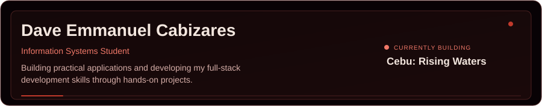
  

  
  

  <a href="https://github.com/mmandled/cebuRisingWater">
    
  </a>
  <a href="https://github.com/mmandled/SASB-Monitor">
    
  </a>
  <a href="https://www.freecodecamp.org/">
    
  </a>
  <a href="https://github.com/mmandled/JavaPractice">
    
  </a>

<a href="https://github.com/mmandled?tab=repositories">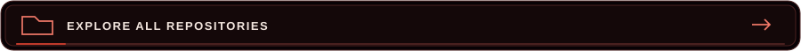</a>



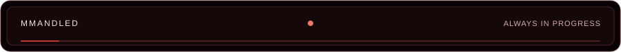
